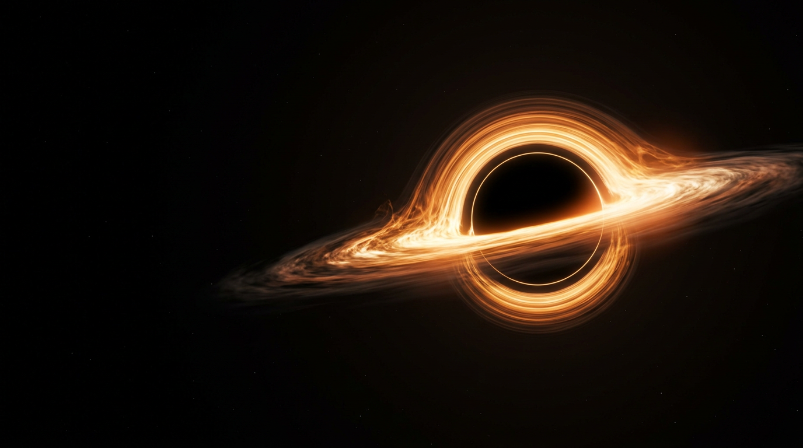

<div align="center">

# BEYOND

### Where light ends. Wonder begins.

**A cinematic, NASA-inspired journey to the edge of a black hole.**

[Visit the Website](https://v0-nexux-pino.vercel.app) · [Explore the Source](https://github.com/musaraf09/NEXUX-NASA-WEBSITE-PROTOTYPE) · [Report an Issue](https://github.com/musaraf09/NEXUX-NASA-WEBSITE-PROTOTYPE/issues)

Built with Next.js · React · TypeScript · Three.js · React Three Fiber

</div>

---

## Live Website

**Explore BEYOND:** [https://v0-nexux-pino.vercel.app](https://v0-nexux-pino.vercel.app)

An immersive space experience featuring a glowing black hole, a dark cinematic interface, and an introduction to the science behind some of the universe’s most mysterious objects.

> This is an independent creative prototype, not an official NASA website. The visualization is an artistic interpretation, not a physically accurate scientific simulation or a live telescope feed.

## Visual Preview



*Warm amber light, deep-black space, and a luminous accretion disk set the visual direction of the experience. This image is the fallback artwork, not a screenshot of the complete website.*

## About the Project

BEYOND brings together space-inspired visual storytelling and interactive web graphics. Its central subject is **Sagittarius A\***, the supermassive black hole at the center of the Milky Way.

The experience moves from a cinematic introduction into approachable explanations of event horizons, gravitational lensing, and accretion disks. Links to official NASA resources let visitors continue learning beyond the prototype.

### Design Direction

- Deep-black backgrounds with warm amber and copper highlights.
- Large editorial headlines paired with mission-control-inspired labels.
- A responsive layout for desktop and mobile screens.
- Purposeful motion, subtle pointer response, and distraction-free exploration.
- Clear visual controls that keep the experience in the visitor’s hands.

## Features

### Interactive Black Hole Visualization

- Custom GLSL shaders rendered through Three.js and React Three Fiber.
- Animated accretion-disk textures, a glowing photon ring, and a procedural starfield.
- Subtle pointer-responsive movement.
- Adjustable disk luminosity.
- Pause and resume controls.

### Immersive Exploration

Select **Explore the black hole** to enter exploration mode. The introductory headline gives way to a more focused view of Sagittarius A*.

- Enter and exit exploration without leaving the page.
- Press **Escape** to leave exploration or dismiss visual settings.
- Use fullscreen where supported by the browser and embedding environment.
- Keep animation controls available during exploration.

### Graceful Graphics Fallback

When WebGL 2 is unavailable, the site displays locally stored cinematic black hole artwork instead of a blank scene. The fallback includes gentle motion, pointer response, and brightness adjustment.

The fallback is an image-based presentation; it is not the shader renderer.

### Science and Discovery

Three educational sections introduce:

| Topic | What visitors discover |
| --- | --- |
| The event horizon | The boundary beyond which light cannot escape. |
| Gravitational lensing | How extreme gravity bends the path of light. |
| The accretion disk | How infalling matter produces a luminous disk around a black hole. |

The page also highlights approximate facts about Sagittarius A* and links to NASA’s Chandra and James Webb mission pages.

### Accessibility and Responsive Design

- Semantic page sections and labeled navigation.
- Accessible names for icon-only controls.
- Visible keyboard focus indicators.
- Reduced-motion preference support that initially pauses animation.
- Responsive mobile navigation and page layouts.
- Text explanations alongside the visual experience.

These features support accessibility but do not constitute a formal accessibility audit.

## Technology Stack

| Technology | Purpose |
| --- | --- |
| Next.js 16 | App Router, page rendering, metadata, and application configuration. |
| React 19 | Component-based interface and interactive state. |
| TypeScript | Static types for application and scene code. |
| Three.js | WebGL graphics and shader materials. |
| React Three Fiber | React-based scene rendering and animation updates. |
| GLSL | Procedural black hole, disk, glow, and starfield effects. |
| Tailwind CSS 4 and custom CSS | Design tokens, styling, responsive layouts, and fallback animation. |
| Lucide React | Navigation and visualization-control icons. |
| Vercel | Website hosting and deployment. |
| pnpm | Dependency management and project scripts. |

## Explore the Website

1. Open the [live website](https://v0-nexux-pino.vercel.app).
2. Select **Explore the black hole** to enter the immersive view.
3. Move your pointer across the scene to shift its presentation subtly.
4. Use the pause/play button to control animation.
5. Open **Visualization settings** to adjust disk luminosity.
6. Use the fullscreen button if your browser permits it.
7. Exit exploration and scroll down to discover the science and NASA mission links.

### Controls Reference

| Control | Action |
| --- | --- |
| Explore the black hole | Enter exploration mode. |
| Exit exploration | Return to the introductory view. |
| Pause / Play | Stop or resume animation. |
| Visualization settings | Open or close visual settings. |
| Disk luminosity slider | Adjust visualization brightness. |
| Fullscreen | Request or exit browser fullscreen. |
| Escape | Leave exploration and close settings. |
| Mobile menu | Expand or collapse navigation on smaller screens. |

## Project Structure

```text
app/
├── globals.css                  # Theme, layouts, responsive styles, and fallback motion
├── layout.tsx                   # Root layout, SEO metadata, and viewport settings
└── page.tsx                     # Main page entry point

components/
├── black-hole-scene.tsx         # WebGL support detection, scene, and custom shaders
└── space-experience.tsx         # Website sections and interactive exploration controls

public/
├── black-hole.png               # Cinematic fallback artwork
└── nasa.svg                     # NASA brand asset

next.config.mjs                 # Next.js configuration and baseline security headers
package.json                    # Dependencies and available scripts
pnpm-lock.yaml                  # Locked dependency versions
README.md                       # Project documentation
```

## Development Setup

For developers working with a local checkout, install a Node.js version supported by the installed Next.js release and the pnpm version declared in `package.json`. The current Vercel project uses Node.js 26.x.

Clone the repository:

```bash
git clone https://github.com/musaraf09/NEXUX-NASA-WEBSITE-PROTOTYPE.git
cd NEXUX-NASA-WEBSITE-PROTOTYPE
```

Install the locked dependencies:

```bash
pnpm install --frozen-lockfile
```

Start the development server:

```bash
pnpm dev
```

The development server normally opens at [http://localhost:3000](http://localhost:3000). If that port is occupied, check the server output for the selected port.

### Available Commands

| Command | Purpose |
| --- | --- |
| `pnpm dev` | Start the Next.js development server. |
| `pnpm build` | Create a production build. |
| `pnpm start` | Serve an existing production build. |
| `pnpm exec tsc --noEmit` | Check TypeScript without emitting files. |

There is currently no dedicated automated test or lint script in `package.json`.

### Environment Variables

The black hole visualization and educational page do not require an external API key, database, or authentication service. The scene is generated in the browser, and the fallback artwork is served from `public/`.

## Customization Guide

| Change | Where to look |
| --- | --- |
| Headline, descriptions, facts, and mission links | `components/space-experience.tsx` |
| Black hole appearance and shader animation | `components/black-hole-scene.tsx` |
| Colors, spacing, typography, and responsive behavior | `app/globals.css` |
| Page title, description, and theme color | `app/layout.tsx` |
| Fallback black hole artwork | `public/black-hole.png` |
| Response headers and framework configuration | `next.config.mjs` |

Keep the fallback experience in mind when modifying the graphics. Not every browser or device can initialize WebGL 2.

## Deployment

The live website is hosted on **Vercel**:

[https://v0-nexux-pino.vercel.app](https://v0-nexux-pino.vercel.app)

For a separate deployment, import the GitHub repository into Vercel, select the Next.js framework preset, and use the package scripts for installation and building. Configure the intended production branch in the hosting project settings.

This is a Next.js application, not a preconfigured GitHub Pages static export. Publishing the repository on GitHub and deploying the website are separate actions.

## Browser Support and Limitations

- The shader renderer requires **WebGL 2** support.
- Unsupported graphics environments receive the animated image fallback.
- Fullscreen availability depends on browser permissions and iframe policies.
- Reduced-motion preferences initially pause animation; visitors can resume it manually.
- Visual settings are temporary and reset when the page is reloaded.
- The visualization is illustrative, not a general-relativistic ray-tracing simulation.
- Educational figures are approximate; consult authoritative sources for scientific work.

## Scientific Resources

Continue exploring through official NASA resources:

- [NASA: Black Holes](https://science.nasa.gov/universe/black-holes/)
- [Chandra X-ray Observatory](https://science.nasa.gov/mission/chandra/)
- [James Webb Space Telescope](https://science.nasa.gov/mission/webb/)
- [NASA Homepage](https://www.nasa.gov/)

## Credits and Attribution

- **Project repository:** [musaraf09/NEXUX-NASA-WEBSITE-PROTOTYPE](https://github.com/musaraf09/NEXUX-NASA-WEBSITE-PROTOTYPE)
- **NASA brand asset:** sourced through [theSVG.org](https://thesvg.org/).
- **Fallback artwork:** AI-generated cinematic artwork created for this prototype; not an actual NASA observation.
- **Graphics:** Three.js, React Three Fiber, and custom GLSL shaders.
- **Icons:** Lucide.

### NASA Disclaimer

This project is independently created and is **not affiliated with, sponsored by, or endorsed by NASA**. NASA names, insignia, and other brand assets remain subject to their applicable usage requirements.

Review the [NASA Brand Center](https://www.nasa.gov/nasa-brand-center/) before reusing NASA branding or presenting this project publicly in another context. Do not imply official NASA ownership or endorsement.

## Contributions and Feedback

Ideas, bug reports, and improvements are welcome through the repository’s [Issues](https://github.com/musaraf09/NEXUX-NASA-WEBSITE-PROTOTYPE/issues) and pull requests.

When reporting a visual or interaction issue, include:

- Browser and operating system.
- Screen size or device model.
- Whether the WebGL visualization or fallback artwork appeared.
- Steps to reproduce the problem.
- A screenshot when helpful.

Keep proposed changes focused, preserve the reduced-motion and fallback behavior, and check TypeScript and the production build before submitting a pull request.

## Licensing

This README does not grant a software license. Refer to any license provided in the repository or contact the repository owner before reuse. Third-party packages and brand assets retain their own licenses and usage terms.

---

<div align="center">

**Keep looking up.**

[Explore BEYOND](https://v0-nexux-pino.vercel.app)

</div>
